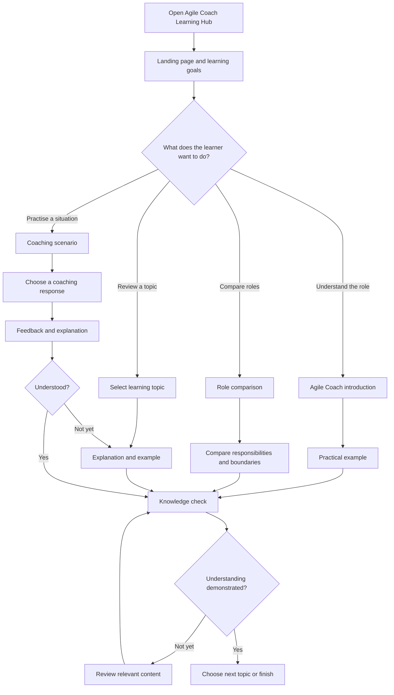

# Design Thinking Session: Mapping User Paths

**Project:** Agile Coach Learning Hub  
**Issue:** [#5 — Conduct a 60-minute Design Thinking session to map user paths](https://github.com/mds-coach-agile/agile-coach/issues/5)  
**Session duration:** 60 minutes  
**Participants:** Student project team (3 members)  
**Facilitator:** Javed Iqbal — Scrum Master  
**Product Owner:** Bator Eshizhamsoev  
**Developers:** Bator Eshizhamsoev, Christian Byemba, Javed Iqbal  
**Client / acceptance authority:** Course teacher  
**Status:** Proposed session plan and working journey hypothesis; replace hypotheses with observations and team decisions recorded during the actual session.

---

## 1. Purpose

Use a focused Design Thinking workshop to understand how a student with limited or uneven knowledge of Agile coaching would use the Agile Coach Learning Hub, identify learning barriers, and map the most important paths through the website.

The goal is not to design a generic business application or a platform for practising Scrum administration. The product is an **interactive educational website** that teaches learners what an Agile Coach is and does, how the role differs from a Scrum Master and a traditional manager, and how coaching behaviours help teams improve.

## 2. Intended users and learning needs

**Primary user:** A student or beginner who is learning Agile and wants a clear, practical understanding of Agile coaching.

**Likely user needs**
- Understand the meaning and purpose of Agile coaching in plain language.
- Distinguish an Agile Coach from a Scrum Master and a manager.
- Recognise coaching stances and know when each may be useful.
- Understand facilitation, team dynamics, conflict resolution, and continuous improvement.
- Apply concepts to realistic team situations rather than only reading definitions.
- Check understanding and receive useful feedback.

**Assumption to validate:** The learner benefits from short explanations, concrete scenarios, visual structure, and interactive knowledge checks. Do not treat this assumption as research evidence until the team has tested it with users.

## 3. Desired outcomes

By the end of the session, the team should have:
1. A shared description of the primary learner and their main learning goal.
2. A concise problem statement based on the learner's perspective.
3. A prioritised end-to-end learner journey.
4. One or more detailed user paths, including decision points and possible exits.
5. A shortlist of usability risks, unanswered questions, and design opportunities.
6. Candidate user stories or backlog items that can be refined by the Product Owner.

## 4. 60-minute agenda

| Time | Activity | What the team does | Output |
|---|---|---|---|
| 00–05 (5 min) | Set the context | Confirm the product purpose, target learner, session goal, and workshop rules. | Shared scope |
| 05–13 (8 min) | Empathise | Describe the learner, their context, motivations, questions, frustrations, and current knowledge. Separate known facts from assumptions. | Learner profile and needs |
| 13–21 (8 min) | Define | Convert the learner's needs into a point-of-view statement and a How Might We question. | Problem statement |
| 21–31 (10 min) | Ideate | Individually sketch possible learning experiences, then share and group ideas. Focus on the learner's goal, not features for their own sake. | Opportunity ideas |
| 31–46 (15 min) | Map user paths | Map the learner's route from landing on the site to understanding a concept and checking learning. Add choices, feedback, recovery paths, and exit points. | Journey map and flow |
| 46–55 (9 min) | Prioritise and validate | Review the map for confusion, missing steps, and excessive complexity. Select the essential path for the first release. | Prioritised path and risks |
| 55–60 (5 min) | Close and assign actions | Summarise decisions, owners, evidence gaps, and backlog candidates. | Session record and actions |

**Total: 60 minutes**

## 5. Facilitation guidance

### 00–05 — Set the context

Facilitator explains:

> We are designing a learning experience that helps students understand Agile coaching and practise applying its principles. We are mapping what the learner needs to do and understand, not deciding the visual design or coding implementation yet.

Rules:
- Focus on the learner, not on what the team personally prefers.
- Give every participant space to contribute.
- Record assumptions separately from evidence.
- Prefer simple, understandable learning steps.
- Avoid scope expansion into accounts, dashboards, project boards, or team-management functions unless user research demonstrates a genuine need.

### 05–13 — Empathise

Use this provisional learner profile as a starting hypothesis and improve it during discussion.

**Learner:** A student who has heard of Agile or Scrum but is unsure what an Agile Coach actually does.

| Dimension | Working hypothesis / prompt |
|---|---|
| Context | Learner visits the site while studying software development methodologies. |
| Goal | Understand the Agile Coach role and apply it to a team situation. |
| Questions | What does an Agile Coach do? How is the role different from a Scrum Master or manager? |
| Frustrations | Abstract terminology, long explanations, unclear examples, and confusing role boundaries. |
| Desired outcome | Explain the role in their own words and choose an appropriate coaching response in a scenario. |
| Evidence to collect | Ask a learner what they already know, what confuses them, and what would help them learn. |

Prompts:
- What does the learner already know about Agile?
- What question would bring them to this website?
- What might make them leave before finishing?
- What would demonstrate that they have learned something?

### 13–21 — Define

Draft point-of-view statement:

> A beginner learning Agile needs a clear and engaging way to understand the Agile Coach role and distinguish it from related roles, because theoretical definitions alone may not show how coaching works in real team situations.

How Might We question:

> **How might we help a beginner understand the role of an Agile Coach and practise choosing helpful coaching behaviours through a simple interactive learning journey?**

Validate and adjust the wording during the workshop.

### 21–31 — Ideate

Each participant independently proposes learning interactions, then shares them. Possible ideas to evaluate:
- A short introductory explanation of Agile coaching.
- A side-by-side comparison of Agile Coach, Scrum Master, and manager.
- Selectable coaching stances with explanations of when to use them.
- A realistic team scenario with choices and explanatory feedback.
- Short sections on facilitation, team dynamics, conflict resolution, and continuous improvement.
- A short quiz or knowledge check with explanations for answers.

Do not attempt to implement every idea. Select ideas that directly support the learner's main goal and can be delivered within the project scope.

## 6. Proposed learner journey map

This is a **starting hypothesis for workshop validation**, not a claim that user testing has already confirmed the journey.

| Stage | Learner action | Learner question / need | Possible difficulty | Website opportunity |
|---|---|---|---|---|
| 1. Discover | Opens the website | What is this site and what will I learn? | Purpose is unclear | Clear title, short introduction, visible start action |
| 2. Orient | Reviews the learning topics | Where should I begin? | Too many choices | Simple learning path and clear topic labels |
| 3. Understand | Reads the Agile Coach introduction | What is an Agile Coach? | Abstract definitions | Plain-language explanation and practical example |
| 4. Compare | Explores role differences | How is this different from a Scrum Master or manager? | Roles appear similar | Direct comparison with responsibilities and boundaries |
| 5. Explore | Learns coaching stances and practices | How does a coach behave in different situations? | Concepts are hard to apply | Examples and short scenario-based interactions |
| 6. Apply | Responds to a team scenario | What would a coach do here, and why? | More than one plausible response | Choice-based scenario with explanatory feedback |
| 7. Check | Completes a knowledge check | Have I understood the key ideas? | Feedback may be too shallow | Quiz with explanations and links back to relevant content |
| 8. Continue | Chooses another topic or revisits content | What should I learn next? | No clear next step | Suggested next topic and simple navigation |

## 7. Core user paths

### Path A — Learner wants to understand the Agile Coach role

`Landing page → Introduction → What an Agile Coach does → Key responsibilities → Practical example → Knowledge check → Next topic`

**Success condition:** The learner can describe the purpose of an Agile Coach and identify at least a few core responsibilities.

### Path B — Learner wants to compare related roles

`Landing page → Role comparison → Agile Coach / Scrum Master / Manager → Compare responsibilities and focus → Example situation → Check understanding`

**Success condition:** The learner can explain meaningful differences between the three roles without assuming they are interchangeable.

### Path C — Learner wants to practise a coaching response

`Learning topics → Coaching stances / team dynamics → Scenario → Choose a response → Receive explanation → Reflect → Retry or continue`

**Success condition:** The learner can select a plausible coaching response and understand why it may be appropriate in the situation.

### Path D — Learner wants to revisit a difficult concept

`Topic or quiz feedback → Reopen relevant explanation → Review example → Retry knowledge check → Continue`

**Success condition:** The learner can recover from a misunderstanding without being forced to restart the entire learning journey.

## 8. High-level user-flow diagram

## 9. Design principles and scope boundaries

The workshop should help the team keep the product focused.

**Prioritise**
- Learning clarity and accessible language.
- Logical progression through concepts.
- Practical examples and scenario-based learning.
- Meaningful feedback that explains why an answer is useful.
- Straightforward navigation and the ability to revisit content.

**Do not assume the product needs**
- User registration, accounts, or learner profiles.
- A project-management dashboard or Scrum board.
- Team collaboration or messaging.
- An AI chatbot or autonomous AI agent.
- Administrative analytics or complex progress tracking.

These may be future opportunities only if supported by user evidence and accepted project scope. The core deliverable remains an interactive educational website.

## 10. Candidate user stories

These are draft backlog candidates, not automatically approved or committed sprint work.

| ID | User story | Indicative priority | Acceptance criteria |
|---|---|---|---|
| US-01 | As a learner, I want a clear introduction to Agile coaching so that I understand the purpose of the role. | Must | The page explains the role in plain language and includes at least one practical example. |
| US-02 | As a learner, I want to compare an Agile Coach, Scrum Master, and manager so that I can distinguish their responsibilities. | Must | The comparison presents meaningful differences in focus and responsibilities. |
| US-03 | As a learner, I want to explore coaching stances so that I can recognise different ways a coach supports a team. | Should | Each included stance has an explanation and an example of when it may be useful. |
| US-04 | As a learner, I want to respond to a realistic team scenario so that I can practise applying coaching concepts. | Should | The learner can choose a response and receives an explanation of the outcome or reasoning. |
| US-05 | As a learner, I want to complete a knowledge check so that I can assess my understanding. | Should | The learner receives clear feedback and can review the relevant learning content. |
| US-06 | As a learner, I want to navigate between topics easily so that I can follow the learning path or revisit concepts. | Must | Topic navigation is visible, understandable, and works across the learning pages. |

## 11. Prioritisation method

Use a simple MoSCoW discussion:
- **Must:** Necessary for the core learning journey to work.
- **Should:** Valuable learning enhancement that follows the core path.
- **Could:** Useful improvement if time permits.
- **Won't for this release:** Outside the agreed scope.

The Product Owner confirms backlog priority after the team has discussed learner value, implementation effort, dependencies, and the project deadline.

## 12. Risks and questions to validate

| Risk / open question | How to validate |
|---|---|
| Learners may not understand the term Agile Coach. | Ask a beginner to explain the term after using the introduction. |
| Role comparison may oversimplify overlapping responsibilities. | Review the content against credible course materials and obtain teacher feedback. |
| Too much text may discourage learners. | Ask a learner to complete a topic and identify where they lose focus. |
| Scenarios may have more than one defensible response. | Review answer explanations with the teacher/client; acknowledge context where appropriate. |
| Learners may not know where to go next. | Observe whether they can continue or revisit a topic without help. |
| The learning path may become too broad for the project timeline. | Prioritise the smallest complete learning journey for the first release. |

## 13. Outputs to capture during the actual session

The facilitator or a nominated note-taker should complete this section during or immediately after the workshop.

- **Date and time:** [Fill in]
- **Participants present:** [Fill in]
- **Learner assumptions confirmed:** [Fill in]
- **New learner insights:** [Fill in]
- **Final problem statement:** [Fill in]
- **Final How Might We question:** [Fill in]
- **Agreed primary user path:** [Fill in]
- **Agreed secondary path(s):** [Fill in]
- **Top usability risks:** [Fill in]
- **Ideas selected for backlog refinement:** [Fill in]
- **Decisions deferred:** [Fill in]
- **Teacher/client feedback (if obtained):** [Fill in]

### Decisions and action log

| Action / decision | Owner | Due date | Status |
|---|---|---|---|
| Consolidate workshop notes and final journey map | Scrum Master / facilitator | [Date] | To do |
| Review and prioritise candidate stories | Product Owner | [Date] | To do |
| Refine acceptance criteria for selected stories | Product Owner + Developers | [Date] | To do |
| Review learning content and role distinctions | Team; seek teacher/client feedback | [Date] | To do |
| Add agreed stories to the product backlog | Product Owner | [Date] | To do |

## 14. Definition of completion for this activity

This issue's work can be considered complete when:
- The 60-minute session has been conducted and attendance is recorded.
- Learner needs and the problem statement are documented.
- The team has reviewed and agreed on the main learner journey.
- At least one primary user path is mapped with key decisions and feedback loops.
- Main usability risks and open questions are recorded.
- Candidate user stories are handed to the Product Owner for prioritisation.
- The workshop notes and journey map are committed to the project documentation.

**Important:** The agenda and journey map in this document are prepared as workshop material. Complete the session record, validate the hypotheses, and replace placeholders with actual outcomes before marking the activity as conducted.
//