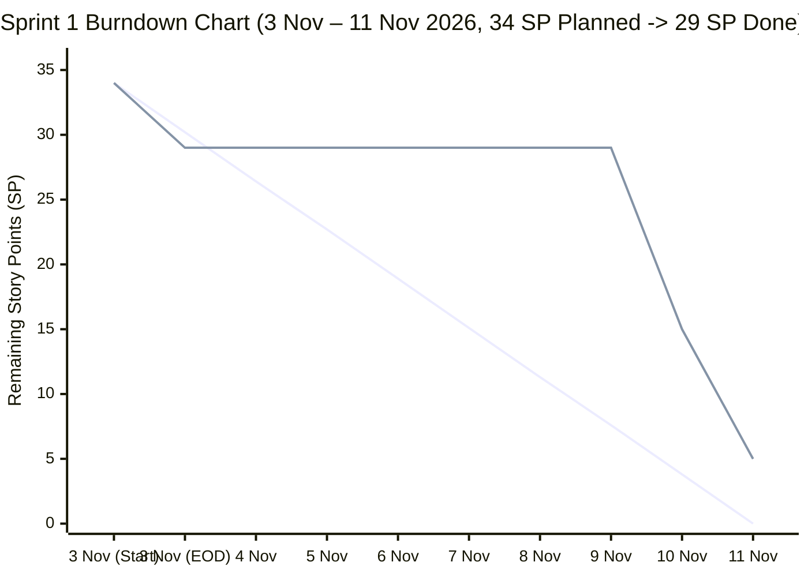
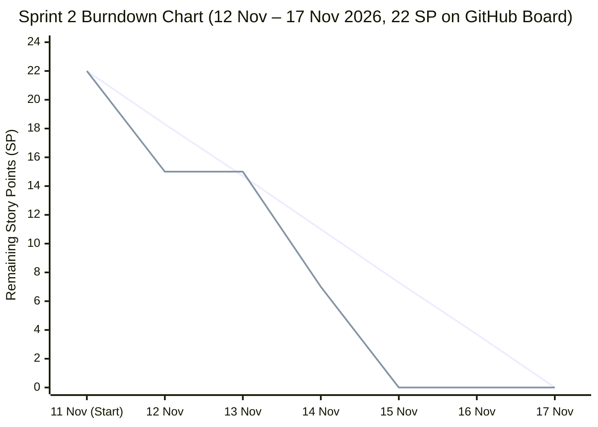
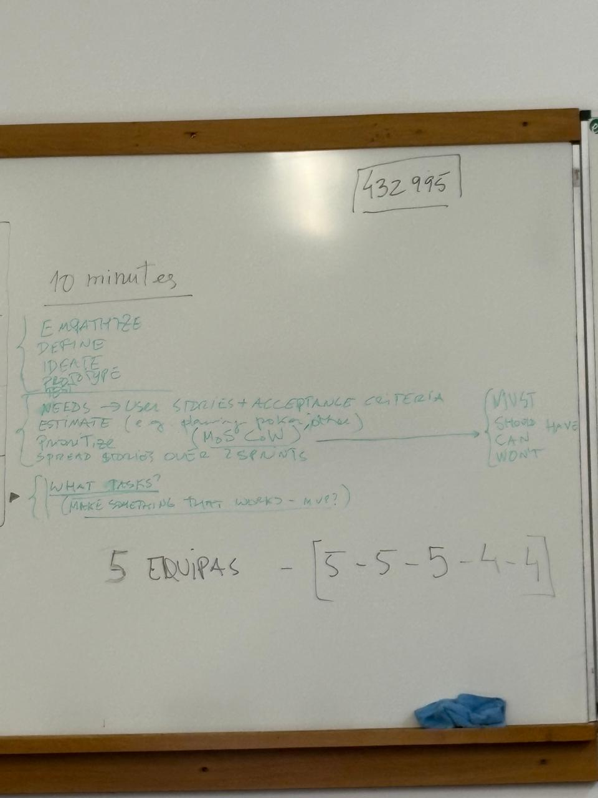
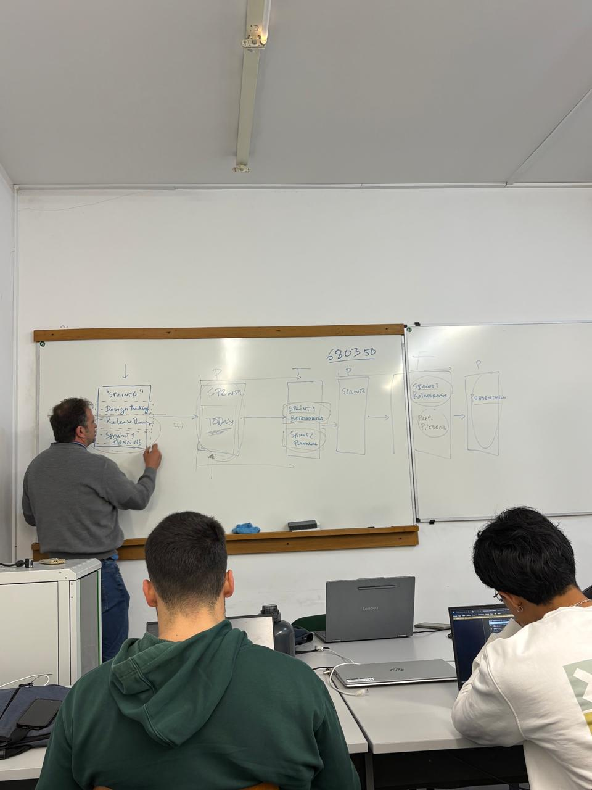

# Final Project Report — Agile Coach Learning Hub

**Course:** Software Development Methodologies (ISEC)  
**Project Period:** 27 October – 17 November 2026  
**Live Product URL:** [https://mds-agile-coach.netlify.app/](https://mds-agile-coach.netlify.app/)  
**GitHub Repository:** [https://github.com/mds-coach-agile/agile-coach](https://github.com/mds-coach-agile/agile-coach)  
**GitHub Projects Backlog:** [https://github.com/orgs/mds-coach-agile/projects/2/views/1](https://github.com/orgs/mds-coach-agile/projects/2/views/1)

---

## 1. Executive Summary & Scrum Team

The **Agile Coach Learning Hub** is an interactive, research-backed educational web application designed to help university students and Agile beginners understand the Agile Coach role, distinguish it from a Scrum Master and a Manager, explore the four coaching stances, practise resolving team conflicts across Speed Leas's five escalation levels, test their knowledge through a scenario-based quiz, and ask questions to an embedded **BOTSchool.ai** conversational assistant.

| Team Member / Role | Scrum Accountability | Key Contributions |
|---|---|---|
| **Bator Eshizhamsoev** | Product Owner & Developer | Product vision, Product Backlog prioritisation, Definition of Done (`PR #10`), React/TypeScript application architecture (`PR #30`, `#47`), CI workflow (`PR #49`), US-04 Conflict Resolution Simulator (`PR #52`), US-07 UI simplification & Practice Hub (`PR #64`), and chatbot widget layout fix (`PR #71`). |
| **Javed Iqbal** | Scrum Master & Developer | Scrum facilitation, Meeting Minutes ([meeting-minutes.md](meeting-minutes.md)), Daily Scrum Log ([daily-scrum-log.md](daily-scrum-log.md)), Design Thinking session & user-path mapping (`PR #16`), Release Plan (`PR #24`), Agile Coach role content & 4 core educational articles (`PR #43`, `#46`), and full academic proofreading (`PR #66`). |
| **Christian Byemba** | Developer | Literature-backed Agile Coach research ([agile-coach-research.md](research/agile-coach-research.md), `PR #8`, `#48`, `#56`), Netlify deployment setup, automated test suite (`PR #38`), BOTSchool.ai training intents & 14-question test set (`PR #41`), iterative chatbot evaluation & agent rebuild (`Runs 1–6`, `14/14` pass, `PR #55`, `#69`), and live widget integration (`PR #68`). |
| **Course Teacher** | Client / Acceptance Authority | Provided domain expectations, evaluated increments at Sprint Reviews, and gave actionable feedback (e.g., UI simplification in Sprint 1 Review). |

---

## 2. Product Vision & Design Thinking Outcomes

### 2.1 Problem Statement & Learner Needs
During the 60-minute **Design Thinking workshop** on 27 October 2026 ([design-thinking-session-user-paths.md](design-thinking/design-thinking-session-user-paths.md)), the team mapped the primary learner persona: a student studying software development methodologies who is familiar with basic Scrum mechanics but struggles with abstract coaching terminology and blurred role boundaries.

- **Point-of-View Statement:** *A beginner learning Agile needs a clear and engaging way to understand the Agile Coach role and distinguish it from related roles, because theoretical definitions alone may not show how coaching behaviours work in real team situations.*
- **How Might We Question:** *How might we help a beginner understand the role of an Agile Coach and practise choosing helpful coaching behaviours through a simple interactive learning journey?*

### 2.2 Mapped User Journey (The 3-Step Learning Path)
Following user-path mapping (refined further in Sprint 2 after teacher feedback), the learning journey was structured into three progressive stages:
1. **Step 1 — Core Modules (01–04):** Four foundational articles (*The Agile Coach Identity*, *The Triad of Roles*, *The Four Coaching Stances*, and *Conflict & Facilitation*) with academic citations and persistent reading progress (`0/4` to `4/4`).
2. **Step 2 — Interactive Frameworks:** Side-by-side Role Comparison Matrix (*Agile Coach vs. Scrum Master vs. Delivery Manager*) with real-world scenarios, and interactive cards for the **4 Coaching Stances** (*Teacher, Mentor, Facilitator, Professional Coach* — Spayd & Adkins, 2011) and **5 Conflict Escalation Levels** (Speed Leas; Adkins, 2010).
3. **Step 3 — Practice & Self-Assessment (`#/practice` + AI Chatbot):**
   - **Conflict Dynamics Simulator (`#/practice/conflict`):** Five realistic team conflict scenarios (Levels 1–5) where learners select a response (Options A/B/C) and receive immediate pedagogical feedback.
   - **Knowledge Check Quiz (`#/practice/quiz`):** Five scenario-based questions with rationales for every option and remediation links to the relevant articles.
   - **BOTSchool.ai Assistant:** Floating webchat widget answering learner questions strictly from the team's verified research document.

### 2.3 Comparison Between Design Thinking Output and Final Product

| Dimension | Design Thinking Output (27 Oct) | Final Delivered Product (17 Nov) | Reason for Evolution |
|---|---|---|---|
| **User Journey Structure** | Linear primary flow (*Path A*: Landing → Intro → Responsibilities → Example → Quiz) plus 3 secondary paths (*B* role comparison, *C* scenario practice, *D* concept revisit). | Structured **3-step progressive journey** on the home page (*Step 1: Core Modules → Step 2: Interactive Frameworks → Step 3: Practice Hub*) with breadcrumb & "next step" navigation. | Sprint 1 Review feedback highlighted that first-time learners needed clearer separation between reading and active practice (`US-07`, `#58`). |
| **Practice & Assessment** | Single embedded quiz (`US-05`) and one team scenario (`US-04`) planned inline on the main page. | Dedicated `#/practice` hub splitting the **5-scenario Conflict Resolution Simulator** (`#/practice/conflict`) and **Knowledge Quiz** (`#/practice/quiz`) with remediation links back to articles. | Separating practice from theory reduced cognitive load and allowed deeper scenario-based feedback across all 5 Speed Leas levels. |
| **AI Chatbot (`US-08`)** | Marked as *Could / "if possible"* (`#29`) due to uncertainty around BOTSchool.ai access. | Fully implemented and embedded **BOTSchool.ai widget** (*Agile Coach assistant 2*) achieving **14/14** on the evaluation test set. | Access blocker (`#9`) was resolved in Sprint 1, and a platform RAG outage was overcome by embedding the verified research base directly in the system prompt. |
| **Scope Exclusions** | Focused purely on beginner learning without accounts or backend storage. | Preserved static SPA architecture on Netlify with `localStorage` reading progress; no user accounts or databases added. | Kept scope aligned with the 2-sprint timebox and avoided non-educational complexity. |

---

## 3. Release Plan, Backlog, Practices & Definition of Done

### 3.1 Release Scope
Defined in the [Release Plan](release-plan/release-plan.md), the product backlog prioritised seven core user stories (`US-01` through `US-07`), the AI chatbot story (`US-08`, `#29`), and supporting engineering/content tasks (`#6`, `#31`, `#59`, `#60`, `#61`). Non-educational features such as user authentication, databases, or Jira-like task boards were explicitly excluded as out of scope.

### 3.2 Agile Practices & Artifacts
- **Planning & Estimation:** Backlog items were tracked on [GitHub Projects #2](https://github.com/orgs/mds-coach-agile/projects/2/views/1) and estimated using Fibonacci Story Points (`2`, `3`, `5 SP`) for product items, while process/ceremony tasks remained unestimated (`0 SP`).
- **Daily Scrum:** Short asynchronous/session-based syncs recorded in [daily-scrum-log.md](daily-scrum-log.md) tracking *Done*, *Today*, and *Blockers*.
- **Meeting Minutes:** Formal records of Sprint 0 Kick-off, Sprint 1 Planning/Review/Retrospective, and Sprint 2 Planning/Review/Retrospective maintained in [meeting-minutes.md](meeting-minutes.md).
- **Engineering Practices:** Feature branches, **cross-review on Pull Requests** (every PR was reviewed and approved by a teammate other than the author before merging to `main`), and automated GitHub Actions CI (`npm test`, `tsc --noEmit`, `npm run build`).

### 3.3 Definition of Done (DoD)
Per [definition-of-done.md](definition-of-done.md), every Product Backlog Item required:
- Responsive and accessible rendering across desktop, tablet, and mobile viewports.
- Functional interactive learning activities (Conflict Simulator and Knowledge Quiz).
- Code review via GitHub Pull Request and passing automated checks (`npm test` — 17 assertions across smoke, navigation, and content suites; `npm run lint`; `npm run build`).
- Proofread educational content verified against primary literature.
- Live production deployment on Netlify from `main`.
- BOTSchool.ai chatbot passing **14/14** questions in the sprint test set.

---

## 4. Project Lifecycle Across Sprints

### 4.1 Sprint 0 (27 October – 3 November 2026) — Discovery & Foundation
- Established Scrum accountabilities, GitHub repository, and Netlify environment (`mds-agile-coach.netlify.app`).
- Completed **Design Thinking** (`#1`, `#5`, `PR #16`), **Definition of Done** (`#2`, `PR #10`), and **Release Plan** (`#20`, `PR #24`).
- Authored the primary research base ([agile-coach-research.md](research/agile-coach-research.md), `#6`, `PR #8`), synthesising *Adkins (2010)*, *Spayd & Adkins (2011)*, *Scrum Guide (2020)*, *Speed Leas*, *Derby & Larsen (2006)*, *Tuckman (1965)*, *Edmondson (1999)*, and *Cohn (2005)*.
- **Impediment Identified (`#9`):** BOTSchool.ai required credit-card details even on the free trial to enable web integration. The team logged `#9`, escalated to the course teacher for academic access, and kept chatbot embedding out of Sprint 1's critical path.

### 4.2 Sprint 1 (3 November – 11 November 2026) — Core Learning Increment
- **Sprint 1 Goal:** *A learner can navigate topics, understand what an Agile Coach does, and tell the role apart from a Scrum Master and a manager.*
- **Delivered Increment:**
  - Built the React + TypeScript + Tailwind CSS web application (`PR #30`, `PR #47`) covering `US-01` (`#27`), `US-02` (`#50`), `US-03` (`#51`), `US-05` (`#28`), and `US-06` (`#26`).
  - Authored and integrated the four core curriculum articles (`#31`, `PR #43`, `#46`, `#47`).
  - Added automated content, navigation, and smoke tests (`PR #38`) and created the chatbot training intents and 14-question test set (`PR #41`).
- **Sprint 1 Review (11 Nov) & Client Feedback** ([meeting-minutes.md](meeting-minutes.md)):
  1. **UI/UX Simplification:** The teacher advised making the website simpler, cleaner, and easier to understand and navigate for first-time learners (captured as `US-07` / Issue `#58`).
  2. **Velocity & Estimation:** Discussed story point estimation and why velocity cannot be used to compare teams (added to the research document in `PR #48`).
- **Sprint 1 Retrospective (11 Nov):**
  - *What went well:* Strong academic rigour and delivery of a full React learning hub with 4 modules and an interactive quiz.
  - *What didn't go well:* Four user stories were merged together in one large pull request (`PR #30`) near the end of the sprint, creating a "cliff" burndown and temporarily breaking smoke tests; Daily Scrum notes and board links were updated late.
  - *Agreed Action Items for Sprint 2:*
    1. **Action 1:** Keep every pull request small and linked to a single issue (All Developers).
    2. **Action 2:** Record the Daily Scrum log during each working session rather than retroactively (Javed, Scrum Master).

### 4.3 Sprint 2 (12 November – 17 November 2026) — Interactive Practice, UI Refinement & AI Chatbot
- **Sprint 2 Goal:** *A student can use the live website to learn about the Agile Coach role, practise with a team scenario and test their knowledge with a quiz.*
- **Delivered Increment:**
  - **Automated CI (`#59`, `PR #49`):** Added GitHub Actions workflow running tests, TypeScript type-checking, and production builds on every PR.
  - **Conflict Resolution Simulator (`US-04`, `#39`, `PR #52`):** Implemented 5 interactive Speed Leas conflict scenarios with coaching choices and feedback.
  - **UI Simplification & Practice Hub (`US-07`, `#58`, `PR #64`):** Directly addressed Sprint 1 Review teacher feedback by introducing a clear 3-step learning path on the home page, adding progressive "next step" links, and moving the Conflict Simulator and Quiz to a dedicated `#/practice` view (`#/practice/conflict` and `#/practice/quiz`).
  - **Academic Proofreading (`#60`, `PR #66`):** Verified all website claims, citations, Scrum Guide 2020 terminology, and quiz hints against primary literature.
  - **BOTSchool.ai Testing & Live Deployment (`#29`, `#61`, `PR #55`, `#56`, `#68`, `#69`, `#71`):** Completed 6 evaluation runs on the 14-question test set, resolved a platform-wide BOTSchool outage by rebuilding the agent as *Agile Coach assistant 2* (**14/14 pass**), embedded the live widget on `https://mds-agile-coach.netlify.app/`, and adjusted widget CSS positioning (`--bsc-offset-y: 76px`) above the Netlify badge.
- **Sprint 2 Retrospective Summary (15–17 Nov)** ([meeting-minutes.md](meeting-minutes.md)):
  - *Evaluation of Sprint 1 Retro Actions:* Both action items succeeded. In Sprint 2, work was delivered through small, single-issue pull requests (`PR #49` to `PR #80`) verified by CI, and `daily-scrum-log.md` was updated session by session (`12 Nov`, `13 Nov`, `14 Nov`, `15 Nov`, `16 Nov`).
  - *What went well:* Smooth, incremental burndown finishing all product development 2 days before the presentation; rapid recovery from the BOTSchool platform bug on 13–15 Nov.
  - *What could be improved next time:* Third-party script overlays (such as the injected Netlify badge overlapping the BOTSchool launcher on production) only appear on the live host domain rather than `localhost`, highlighting the importance of visual QA directly on Deploy Previews and production URLs.

---

## 5. Sprint Burndown Charts & Team Velocity Analysis

### 5.1 Story Point Estimation on GitHub Projects (#2)
On the [GitHub Projects board](https://github.com/orgs/mds-coach-agile/projects/2/views/1), backlog items are categorised into:
- **Product and Development (13 items, 51 Story Points total):** User stories, core content tasks, CI automation, and chatbot integration carrying Fibonacci Story Point estimates (`2`, `3`, `5`).
- **Methodology and Processes (15 items, unestimated / 0 SP):** Scrum ceremonies, meeting minutes, release planning, and final report/presentation tasks, kept unestimated so team Velocity strictly measures product delivery.

| Sprint | Issue | Product & Development Item | Assignee | Estimate (SP) | Status & Completion Date |
|---|---|---|---|---:|---|
| **Sprint 1** | `#6` | Research the "Agile Coach" role and gather reference materials | Christian | **5 SP** | ✅ Done (3 Nov, `PR #8`) |
| **Sprint 1** | `#26` | `[US-06]` Home Page and Topic Navigation | Bator | **3 SP** | ✅ Done (10 Nov, `PR #30`, `#38`) |
| **Sprint 1** | `#28` | `[US-05]` Interactive Knowledge Quiz | Bator | **5 SP** | ✅ Done (10 Nov, `PR #30`) |
| **Sprint 1** | `#50` | `[US-02]` Role Comparison: Agile Coach vs Scrum Master vs Manager | Bator | **3 SP** | ✅ Done (10–11 Nov, `PR #30`, `#47`) |
| **Sprint 1** | `#51` | `[US-03]` 4 Coaching Stances Framework | Bator | **3 SP** | ✅ Done (10–11 Nov, `PR #30`, `#47`) |
| **Sprint 1** | `#27` | `[US-01]` Introduction to Agile Coaching | Javed | **5 SP** | ✅ Done (11 Nov, `PR #30`, `#43`) |
| **Sprint 1** | `#31` | `[Task]` Draft Content for Core Educational Articles (Modules 01–04) | Javed | **5 SP** | ✅ Done (11 Nov, `PR #46`, `#47`) |
| *Sprint 1 Subtotal* | | *7 Product/Dev items (+ 7 Process items completed)* | | **29 SP** | **29 SP Completed in Sprint 1** *(+ `#39` 5 SP moved to Sprint 2)* |
| **Sprint 2** | `#39` | `[US-04]` Realistic Team Scenario: Conflict Resolution *(from Sprint 1)* | Bator | **5 SP** | ✅ Done (12 Nov, `PR #52`) |
| **Sprint 2** | `#59` | `[QA/CI]` Automated GitHub Actions CI and Navigation Test Fixes | Bator | **2 SP** | ✅ Done (12 Nov, `PR #49`) |
| **Sprint 2** | `#58` | `[US-07]` Simplify Website UI and Improve Navigation Clarity | Bator | **5 SP** | ✅ Done (14 Nov, `PR #64`) |
| **Sprint 2** | `#60` | `[Content]` Proofread and Verify Educational Content | Javed | **3 SP** | ✅ Done (14 Nov, `PR #66`) |
| **Sprint 2** | `#29` | `[US-08]` BOTSchool.ai Chatbot Integration Test Set | Christian | **5 SP** | ✅ Done (15 Nov, `PR #41`, `#48`, `#55`, `#56`, `#69`) |
| **Sprint 2** | `#61` | `[Deploy]` Production Netlify Deployment & Chatbot Widget Embed | Christian | **2 SP** | ✅ Done (15 Nov, `PR #68`, `#71`) |
| *Sprint 2 Subtotal* | | *6 Product/Dev items (+ 3 Process items: `#53`, `#62`, `#63`)* | | **22 SP** | **22 SP Completed (100% by 15 Nov)** |
| **RELEASE TOTAL** | | **13 Product/Dev items + 15 Process items (28 Board Cards)** | | **51 SP** | **51 / 51 SP Done (Average Velocity: 25.5 SP / sprint)** |

---

### 5.2 Sprint 1 Burndown Analysis (3 Nov – 11 Nov 2026)

Including `US-04` (`#39`, 5 SP), which was initially selected in Sprint 1 Planning before being moved to Sprint 2, the initial Sprint 1 commitment was **34 SP** (**29 SP** completed in Sprint 1, **5 SP** carried over):

| Date | Ideal Remaining (SP) | Actual Remaining (incl. `#39`, 34 SP) | Actual Remaining (Board Sprint 1, 29 SP) | Completed Items & Evidence |
|---|---:|---:|---:|---|
| **3 Nov (Start)** | 34.0 | **34** | **29** | Sprint 1 Planning baseline |
| **3 Nov (EOD)** | 30.2 | **29** | **24** | `#6` Agile Coach research merged (`PR #8`, −5 SP) |
| **4–9 Nov** | 26.4 → 7.6 | **29** | **24** | Feature development in branches; process items `#1–#5`, `#7`, `#20`, `#21` closed |
| **10 Nov** | 3.8 | **15** | **10** | `PR #30` merged (−14 SP: `#26` [3 SP], `#28` [5 SP], `#50` [3 SP], `#51` [3 SP]) |
| **11 Nov** | 0.0 | **5** | **0** | `PR #43`, `#46`, `#47` merged (−10 SP: `#27` [5 SP], `#31` [5 SP]). `#39` (5 SP) moved to Sprint 2 |

**Key Observation:** Sprint 1 achieved a high velocity (**29 SP**), but exhibited a flat plateau from 4 to 9 November followed by a steep 24-SP drop on 10–11 November (*late-merge cliff*) because four user stories were bundled into a single large pull request (`PR #30`).

---

### 5.3 Sprint 2 Burndown Analysis (12 Nov – 17 Nov 2026)

| Date | Ideal Remaining (SP) | Actual Remaining (SP) | Completed Items & Evidence |
|---|---:|---:|---|
| **11 Nov (Start)** | 22.0 | **22** | Sprint 2 backlog: `#39` (5 SP), `#59` (2 SP), `#58` (5 SP), `#60` (3 SP), `#29` (5 SP), `#61` (2 SP) |
| **12 Nov** | 18.3 | **15** | `PR #49` (`#59` CI & test fixes, −2 SP) and `PR #52` (`#39` Conflict Simulator, −5 SP) merged |
| **13 Nov** | 14.7 | **15** | `#58` (`US-07` Practice Hub) in progress; Chatbot Runs 4–5 executed (`13/14`) |
| **14 Nov** | 11.0 | **7** | `PR #64` (`#58` UI simplification, −5 SP) and `PR #66` (`#60` Content proofreading, −3 SP) merged |
| **15 Nov** | 7.3 | **0** | `PR #69` (`#29` Chatbot Run 6 `14/14`, −5 SP) and `PR #68`/`#71` (`#61` Live widget & deploy, −2 SP) merged |
| **16–17 Nov** | 3.7 → 0.0 | **0** | All 22 SP completed 2 days early; final report (`#62`) and presentation rehearsal (`#63`) |

**Key Observation:** Applying Sprint 1 Retrospective Action #1 (small, single-issue pull requests) transformed the Sprint 2 burndown into a smooth, predictable staircase (`−7 SP` on 12 Nov, `−8 SP` on 14 Nov, `−7 SP` on 15 Nov) that stayed consistently ahead of the ideal burndown trajectory.

---

### 5.4 Velocity Interpretation
- **Sprint 1 Velocity:** `29 SP` (out of `34 SP` initially committed; `US-04` carried over).
- **Sprint 2 Velocity:** `22 SP` (100% of Sprint 2 commitment completed 2 days ahead of schedule).
- **Average Velocity:** `25.5 SP / sprint`.
- **Interpretation:** The change from `29 SP` to `22 SP` does not represent a drop in team productivity. Sprint 1 had a larger initial content/scaffolding batch and a shorter effective integration window, whereas Sprint 2 intentionally scoped `22 SP` of higher-risk integration work (live BOTSchool.ai debugging, CI setup, and UI refactoring) while reserving 16–17 November for final documentation and presentation rehearsal. In line with Scrum principles (Cohn, 2005), velocity is strictly a local forecasting tool for this 3-person team and cannot be used as a productivity target or to compare different teams.

---

## 6. BOTSchool.ai Chatbot Evaluation & Outage Resolution

Full testing documentation is maintained in [docs/chatbot/test-set.md](chatbot/test-set.md) and [docs/chatbot/training-intents.md](chatbot/training-intents.md):
- **Evaluation Protocol:** 14 structured checks — 12 domain questions (`Q1–Q12`) requiring specific bolded concepts and academic citations from [docs/research/agile-coach-research.md](research/agile-coach-research.md), plus 2 out-of-scope guardrail tests (`O1` weather in Coimbra, `O2` Python homework).
- **Iterative Refinement (Runs 1–5):**
  - *Run 1 (11 Nov):* `12/14` (`Q3` and `Q10` gave correct "No" answers but omitted the underlying rationale). Fixed by adding Instruction 9 (always justify yes/no answers with author and year) and expanding the velocity and role-origin sections in the research document (`PR #48`, `PR #56`).
  - *Runs 4–5 (13 Nov):* `13/14` (only `Q1` remained borderline because the GitHub URL knowledge source had not re-indexed; fixed by uploading the updated Markdown file directly).
- **Platform Outage Diagnosis & Rebuilt Agent (13–15 Nov):**
  - On 13 Nov at 19:20, the BOTSchool playground stopped returning replies. Systematic isolation on a separate test agent on 14 Nov revealed two platform regressions on BOTSchool: (1) enabling *any* built-in guardrail blocked 100% of responses, and (2) the RAG knowledge-search tool failed at runtime despite passing index health checks.
  - **Solution (*Agile Coach assistant 2*):** On 15 Nov, the agent was rebuilt on Claude Sonnet 5 with the complete `main` version of `agile-coach-research.md` embedded directly in the system prompt between `KNOWLEDGE BASE START/END` markers, paired with Instruction 10 (*"It is your only source"*).
  - **Run 6 & Production Verification (15 Nov):** Passed **14 / 14 (100%)** in Run 6 (`PR #69`), published to the `Agile Coach Learning Hub` web channel, and verified live on `https://mds-agile-coach.netlify.app/` (`PR #68`, `PR #71`).

---

## 7. AI Usage Statement

In compliance with course academic integrity guidelines, the team transparently documents all AI tools used during the project and the human verification applied to every output:

| AI Tool / Platform | Purpose in the Project | Human Validation & Quality Control |
|---|---|---|
| **Claude (Anthropic) / Claude Code** | Assisted in drafting initial research summaries, wording chatbot training intents (`training-intents.md`), proofreading checks, and running browser-automated chatbot evaluation sessions. | Every concept, quote, author, and publication year in `agile-coach-research.md` and `src/data/` was manually verified against primary sources (*Scrum Guide 2020, Adkins 2010, Spayd & Adkins 2011, Speed Leas, Derby & Larsen 2006, Edmondson 1999, Tuckman 1965, Cohn 2005*). Inaccurate claims were corrected in `PR #48`, `#56`, and `#66`. |
| **Lovable.dev & Google Antigravity** | Assisted with React + TypeScript + Tailwind UI scaffolding, navigation refactoring (`US-07`), CI configuration, CSS stacking/offset fixes for the chatbot widget (`PR #71`), and generating burndown visualizations. | All code underwent peer review via GitHub Pull Requests, automated testing (`17/17` tests in `tests/`), TypeScript strict checking (`tsc --noEmit`), and manual cross-device testing on Netlify Deploy Previews. |
| **BOTSchool.ai** | Hosted the conversational AI assistant (*Agile Coach assistant 2*) embedded on the live learning hub. | Grounded strictly in the team's peer-reviewed research document and verified across 6 formal test runs until achieving **14/14** accuracy. |

---

## 8. Critical Analysis: Team & Personal Reflections

### 8.1 Team Analysis & Lessons Learned
Working as a **3-person team** (below the standard 4–5 person guideline) meant that both the Product Owner and Scrum Master also served as active Developers. Despite the extra coordination load, applying Scrum empirically produced three clear takeaways:
1. **Small, Single-Issue Pull Requests Enable True Agile Flow:** Comparing our Sprint 1 and Sprint 2 burndown charts provided concrete empirical evidence of why batch size matters. Splitting Sprint 2 work into small, single-issue PRs backed by GitHub Actions CI eliminated integration bottlenecks and made daily progress immediately visible.
2. **Responding to Client Feedback Improves Pedagogical Clarity:** Acting on the teacher's Sprint 1 Review feedback (`US-07`) transformed the user experience: separating passive reading (home page 3-step guide & articles) from active practice (`#/practice` simulator & quiz) reduced cognitive load for beginners.
3. **Proactive Risk Management & Technical Adaptability:** When external dependencies failed — first the BOTSchool credit-card gate (`#9`) and later the BOTSchool RAG/guardrail platform outage on 13–14 November — isolating the root cause experimentally allowed us to re-architect the agent prompt and still deliver a 100% verified chatbot on schedule.

### 8.2 Personal Analysis & Individual Reflections

#### Bator Eshizhamsoev (Product Owner & Developer)
Looking back at the project, I see that we significantly underestimated its technical and content complexity during Sprint 0 and Sprint 1. Operating as a 3-person team while balancing Product Owner and Developer responsibilities meant our initial capacity assumptions were overly optimistic: `US-04` (`#39`) had to be deferred to Sprint 2, and most Sprint 1 implementation accumulated in branches until a single large merge (`PR #30`), creating a "cliff" burndown and temporarily breaking smoke tests.

As Product Owner, I also made mistakes in how I structured and scoped backlog items early on. Several tasks lacked sharp boundaries and granular acceptance criteria, which resulted in multiple pull requests for a single issue (such as `#29`) while other stories were bundled together. This reduced board transparency and made daily progress harder to track.

Identifying these issues openly during the Sprint 1 Retrospective was the turning point for our process. In Sprint 2, we adopted small, single-issue pull requests backed by automated CI, and I reprioritised the backlog around the teacher's Sprint 1 Review feedback by introducing `US-07` (`#58`)—simplifying the UI into a clear 3-step learning path and separating active practice into `#/practice`. Together with clearer task scoping, this helped us maintain a steady burndown and finish all 22 SP two days ahead of schedule.

#### Javed Iqbal (Scrum Master & Developer)
*[TODO: Add personal reflection on Scrum Master facilitation, keeping Scrum artefacts updated in Sprint 2, content proofreading, and key takeaways.]*

#### Christian Byemba (Developer)
*[TODO: Add personal reflection on research rigour, BOTSchool.ai troubleshooting/outage resolution, testing/deployment, and key takeaways.]*

---

## 9. Process Evidence (Screenshots & Photos)

### In-Class Planning & Scrum Roadmap (Whiteboard)
- **Sprint 0 Kick-off (27 Oct 2026):** Design Thinking stages (*Empathize, Define, Ideate, Prototype, Test*), User Stories + Acceptance Criteria, Planning Poker estimation, and MoSCoW prioritisation across 2 sprints.  
  
- **Sprint Timeline & Ceremonies Roadmap (10 Nov 2026):** In-class Scrum workflow mapping Sprint 0, Sprint 1 Review/Retrospective, Sprint 2 Planning, Sprint 2 Retrospective, and Final Presentation.  
  

### Digital Artefacts & Live Product
*[TODO: Add screenshots of the GitHub Projects board, Burndown/PR history, live Netlify site, and BOTSchool.ai assistant evaluation.]*

---

## 10. References

1. Adkins, Lyssa. *Coaching Agile Teams: A Companion for ScrumMasters, Agile Coaches, and Project Managers in Transition*. Addison-Wesley, 2010.
2. Cohn, Mike. *Agile Estimating and Planning*. Prentice Hall, 2005.
3. Derby, Esther, and Diana Larsen. *Agile Retrospectives: Making Good Teams Great*. Pragmatic Bookshelf, 2006.
4. Edmondson, Amy. "Psychological Safety and Learning Behavior in Work Teams." *Administrative Science Quarterly*, 44(2), 1999.
5. Schwaber, Ken, and Jeff Sutherland. *The Scrum Guide: The Definitive Guide to Scrum: The Rules of the Game*. 2020. [https://scrumguides.org](https://scrumguides.org)
6. Spayd, Michael K., and Lyssa Adkins. *Developing Great Agile Coaches: Towards a Framework of Agile Coaching Competency*. Agile Coaching Institute, 2011.
7. Tuckman, Bruce W. "Developmental Sequence in Small Groups." *Psychological Bulletin*, 63(6), 1965.
